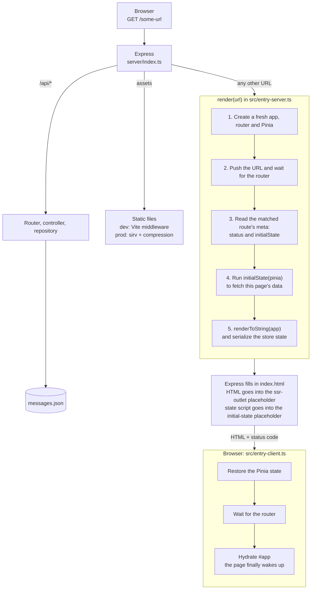

# Skyrim Mail

<samp>*Hey, you. You're finally awake.*</samp>

A Skyrim-inspired email client interface, built with Vue 3 and a hand-written server-side rendering (SSR) setup.

This is a learning project and a work in progress. It is not a real email client yet: the messages come from a JSON file, and there is no sending, no accounts and no persistence. Feedback is welcome.

## Why this exists

The interface idea comes from [a video by juxtopposed](https://www.youtube.com/watch?v=0N87f5wfxr0) and their [Skyrim UI x Email Client](https://www.figma.com/community/file/1484459132775206005/skyrim-ui-x-email-client) design on Figma.

The SSR part is my own addition. I wanted a project I would enjoy working on, and a reason to learn how server-side rendering works underneath. So the server is wired by hand (Express, Vite and Vue's own server renderer) instead of using a framework such as Nuxt.

## What it does today

- Renders pages on the server, with data already in the HTML, then hydrates them in the browser.
- One real page: a navbar, a sidebar placeholder, a resizable message list and an empty reading pane.
- A 404 page ("Not all those who wander are lost") that is also sent with a real `404` status code.
- A small read-only API that serves messages from `server/data/messages.json`.

## How the SSR works



Route `meta` is how a page declares its own status code and data loader (`src/router/routes.ts`).

## Things learned along the way

- **State must not be shared between requests.** The app, router and Pinia are created again for every request. A module-level Pinia instance would leak one visitor's state into another's page.
- **The server router has to be driven by hand.** On the server it uses memory history, and nothing navigates it by itself, so the URL is pushed explicitly and `isReady()` is awaited before rendering. The client uses the browser history and waits for the router before hydrating, to avoid hydration mismatches with lazy-loaded routes.
- **Serialized state is user data inside a `<script>` tag.** It is serialized with [devalue](https://github.com/sveltejs/devalue), because plain `JSON.stringify` lets a message containing `</script>` break out of the tag. The state is also inserted with a function replacer in `String.replace`, because strings like `$&` and `$'` in a plain replacement string are interpreted as patterns.
- **Data loaders receive the request's Pinia.** Calling a store without an explicit Pinia falls back to a global "active" instance, which is not safe when several requests are in flight.
- **`tsx --watch` kept restarting** the dev server in a loop alongside Vite's dev server, while the `tsx watch` subcommand did not, so the dev script uses the latter.

## Tech stack

- [Vue 3](https://vuejs.org/) with [Vue Router](https://router.vuejs.org/) and [Pinia](https://pinia.vuejs.org/)
- [Vite](https://vite.dev/) 7 and [Express](https://expressjs.com/) 5
- TypeScript, [Tailwind CSS](https://tailwindcss.com/) 4
- Small helpers: axios, devalue, sirv, compression, dotenv, tsx, unplugin-auto-import
- pnpm, ESLint, Prettier

## Getting started

You need [Node.js](https://nodejs.org/) (developed on v24) and [pnpm](https://pnpm.io/).

```bash
pnpm install
```

Create a `.env` file in the project root. While rendering, the server fetches its data from its own API, so the variable points back at the app:

```
VITE_API_URL=http://localhost:5173/api
```

Then start the dev server at <http://localhost:5173> (the port is fixed in `server/index.ts`):

```bash
pnpm dev
```

To try the production build, set `VITE_API_URL` first (Vite reads it at build time), then:

```bash
pnpm build
pnpm preview
```

## Project structure

```
server/
  index.ts            Express app: dev/prod handling, /api, the SSR handler
  api/                routes → controllers → repositories
  data/messages.json  the seed messages
src/
  main.ts             createApp(): app + router + Pinia, shared by both entries
  entry-server.ts     render(): the server-side half of SSR
  entry-client.ts     hydration in the browser
  router/             router factory and route definitions (with meta)
  pages/ layouts/     pages and the layout around them
  components/         UI components, including the SVG buttons
  stores/ api/ model/ Pinia store, axios client and types
```

## Roadmap

This is a direction for the project. What I plan to do, with no fixed timeline.

**In progress**

- Refetch a page's data when navigating in the browser. The route `initialState` hook only runs on the server today, so it also needs to run from a router guard on the client, while the first load keeps using the state sent by the server.

**Next**

- Build out the app itself: the reading pane and the sidebar, which are placeholders for now.
- Tighten the API: honor the `count` query parameter and return a 404 for unknown API paths.
- Remove the brief flash of unstyled content in development, where Vite injects CSS through JavaScript. The production build already links the stylesheet in the HTML.

**Later**

- looksmaxxing: Match the Figma design and Skyrim-style menus!
- Automated tests and continuous integration.

## Credits and disclaimer

- Idea: the [juxtopposed video](https://www.youtube.com/watch?v=0N87f5wfxr0) and the [Figma Community design](https://www.figma.com/community/file/1484459132775206005/skyrim-ui-x-email-client). See those pages for their authors.
- This is a non-commercial fan project. It is not affiliated with or endorsed by Bethesda Softworks or ZeniMax. Skyrim and related names and imagery belong to their respective owners.

## License

MIT. See [LICENSE](LICENSE).
